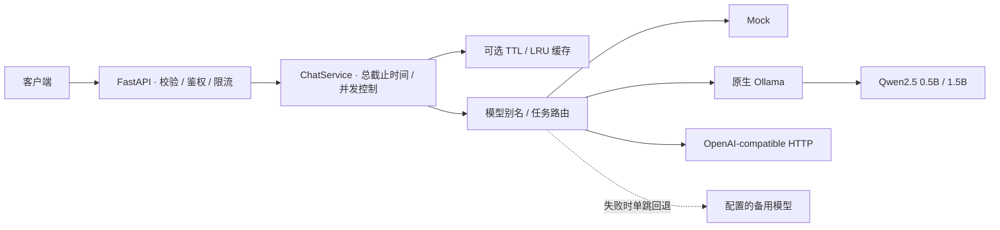

# LLM Gateway

[](https://github.com/FouHe0720/llm-gateway-service/actions/workflows/ci.yml)

用一个异步 Python 服务接入本地 Ollama 和 OpenAI-compatible 模型，统一处理流式返回、超时、重试、缓存与模型路由。

这个项目关心两个问题：上游变慢或失败时，网关怎样收住请求；多加一层网关和调用策略，到底要付出多少延迟。
实现之外，仓库保留了在 **RTX 3050 Laptop / 4 GB 显存**上跑出的对照实验，以及逐请求原始数据。
默认使用 Mock，体验接口和运行测试都不需要模型或 API Key。

[快速运行](#快速运行) · [实测结果](#实测结果) · [实验方法](docs/BENCHMARK.md) · [架构](docs/ARCHITECTURE.md)


## 快速运行

需要 Python 3.11+，推荐 3.12；以下命令适用于 Linux / WSL。安装脚本优先使用 uv 和锁文件，也支持标准 venv/pip。

```bash
git clone https://github.com/FouHe0720/llm-gateway-service.git
cd llm-gateway-service
make install
make demo
```

`make demo` 会启动一个临时 Mock 实例，演示普通请求、SSE 和错误处理，结束后自动退出。
要保留服务供自己调用：

```bash
cp -n .env.example .env
make run
```

另开一个终端：

```bash
curl -sS http://127.0.0.1:8000/v1/chat \
  -H 'Content-Type: application/json' \
  --data-binary @examples/chat.json

curl -N http://127.0.0.1:8000/v1/chat/stream \
  -H 'Content-Type: application/json' \
  --data-binary @examples/chat.json
```

接口文档：<http://127.0.0.1:8000/docs>。默认 Mock 回显输入；SSE 按 `start → delta → done` 返回，失败以 `error` 结束。
`.env.example` 仅为开发用 Mock 关闭了鉴权，接入真实模型时需要配置 Gateway Key。
更多请求示例见 [DEMO](docs/DEMO.md)。

## 请求经过哪些地方



- **连接与取消**：Provider 共用异步 HTTP 连接池。总截止时间包含排队与退避，客户端断开后关闭上游流并释放并发名额。
- **故障恢复**：对连接错误、429 和部分 5xx 做有限重试；读取超时不自动重放。非流式请求可配置一个备用模型，所有尝试共用总预算。
- **缓存与路由**：有容量限制的 TTL/LRU 缓存；根据调用方给出的 `task_type` 选择模型。两者默认关闭，可以单独比较效果。
- **请求记录**：响应 metadata 包含尝试、重试、回退、缓存和排队信息。原生 Ollama 适配器保留 token 数、模型加载和生成耗时。

SSE 开始后不重试或回退，避免客户端收到重复内容。日志不记录 Prompt、Key 或上游响应正文；指标使用固定路由维度。

| 接口 | 用途 |
| --- | --- |
| `POST /v1/chat` | 普通文本对话 |
| `POST /v1/chat/stream` | SSE 增量文本 |
| `GET /v1/models` | 已启用的模型别名 |
| `GET /health` | 进程存活检查 |
| `GET /metrics` | 请求、错误、取消与延迟统计（JSON） |

这是自定义的文本对话 API。请求字段、错误码和流事件见 [API 说明](docs/API.md)；目前不支持工具调用和多模态。

## 接入本地模型

先自行安装并启动 Ollama，准备 `qwen2.5:0.5b` 或 `qwen2.5:1.5b`，再修改 `.env`：

```dotenv
GATEWAY_AUTH_ENABLED=true
GATEWAY_API_KEY=REPLACE_WITH_A_RANDOM_SECRET_AT_LEAST_16_CHARS
GATEWAY_MODELS='[{"model":"qwen-0.5b","provider":"ollama","upstream_model":"qwen2.5:0.5b"}]'
OLLAMA_BASE_URL=http://127.0.0.1:11434
OLLAMA_CONTEXT_LENGTH=1024
```

重启后，请求中使用 `model: "qwen-0.5b"`，并添加 `Authorization: Bearer <Gateway Key>`。
4 GB 显存下，实验采用一次驻留一个模型、从并发 1 开始的设置。
双模型映射、任务路由和 OpenAI-compatible 配置见 [.env.example](.env.example) 与 [接入说明](docs/API.md#provider-配置)。

## 实测结果

测试于 **2026-10-21**，环境为 WSL2、Ryzen 7 6800H、RTX 3050 Laptop 4 GB、Ollama 0.34.4。
Mock 共 **8,031 条请求**，真实 Qwen2.5 实验共 **308 条请求**。以下数字取自仓库内的 CSV/JSONL：

| 实验 | 观察到的结果 |
| --- | --- |
| **A · 网关开销** | 20 ms Mock、并发 1：热态配对 ΔP95 的三轮中位数为 **+3.05 ms**。并发升到 20/50 后，开销与波动明显增大。 |
| **B · 故障恢复** | 20% 请求首次返回 503/429，重试使成功率从 **80% 到 100%**。永久连接失败时，仅重试仍为 0%；配置备用模型后可恢复。 |
| **C · 缓存** | 真实 0.5B、每组 10 条、90% 重复：模型调用从 **10 次降到 1 次**。P50 降低，含冷启动的 P95 没有改善。 |
| **D · 模型路由** | 固定 18 题测两轮：全 0.5B / 全 1.5B / 按任务路由的严格匹配率为 **22.2% / 55.6% / 33.3%**。路由频繁切换模型，加载开销上升。 |
| **E · 真实推理** | 0.5B、并发 1、热态：直连 / 网关的 TTFT P95 为 **17.51 / 17.64 ms**，端到端 P95 为 **277.11 / 280.76 ms**（两轮指标中位数）。 |

这次实验里，缓存节省了重复推理；任务路由没有优于全部使用 1.5B。
单模型驻留时的加载代价，比路由规则本身更影响体验。
完整数值和失败案例见 [结果表](docs/BENCHMARK_RESULTS.md) 与 [分析](docs/FAILURE_ANALYSIS.md)。


报告中可以切换 A–E、冷热阶段和数据类型，查看逐轮波动、配对开销与显存曲线。
[下载或克隆仓库后打开 HTML](benchmarks/reports/index.html)，也可以在项目根目录启动本地预览：

```bash
.venv/bin/python -m http.server 8080 --bind 127.0.0.1
# 打开 http://127.0.0.1:8080/benchmarks/reports/index.html
```

<details>
<summary>复现实验与核对原始数据</summary>

```bash
make benchmark-mock-quick  # 一轮流程检查，无需 GPU
make benchmark-mock       # 三轮 Mock 实验
make benchmark-real       # 已准备 Ollama 与双模型时运行
make benchmark-report
.venv/bin/python -m scripts.verify_benchmark_results
```

[Mock 原始记录](benchmarks/results/20261021T053001Z-mock-33f3d4/) · [真实模型原始记录](benchmarks/results/20261021T054417Z-real-bdb4f7/)

每次运行保存随机种子、配置、时间、硬件、模型 digest 与源码指纹。
实验规模、指标定义、模型准备和降规模方法见 [BENCHMARK](docs/BENCHMARK.md)。
未执行的指标在报告中显示“未测试”。Mock 与真实推理分开统计，重新生成报告不会改写原始记录。

</details>

## 开发与测试

```bash
make lint test
make demo
# Docker 部署
cp -n .env.example .env
docker compose up --build -d --wait
make smoke
docker compose down
```

当前 **78 项 pytest 测试**覆盖 Provider、超时与重试、缓存和回退、SSE 增量消费与取消清理。
CI 在 Python 3.11 / 3.12 / 3.13 上运行，并验证 Docker 和无需 GPU 的 Mock Benchmark。
每次 CI 的 Mock 数据与 HTML 报告可在 Actions artifact 中下载。

## 使用边界

服务目前按**单进程、单实例**设计：限流、缓存和指标都保存在内存中。多副本需要共享配额、缓存及外部指标聚合；入口还需要控制连接数和等待队列。
健康接口只检查进程存活，不探测模型。部署配置与具体取舍见 [TECH_DECISIONS](docs/TECH_DECISIONS.md)。

实验样本较小，18 道题的严格匹配率同时受答案内容和格式影响。冷启动没有清空 OS 页缓存，Ollama 的模型端并行度为 1，因此客户端并发 2 主要测到排队。
这些结果用于判断当前笔记本上的开销和策略取舍，不代表通用模型能力或生产容量。

[架构与资源生命周期](docs/ARCHITECTURE.md) · [API 说明](docs/API.md) · [实验说明](docs/BENCHMARK.md) · [验证记录](docs/VALIDATION.md)

[MIT License](LICENSE)
