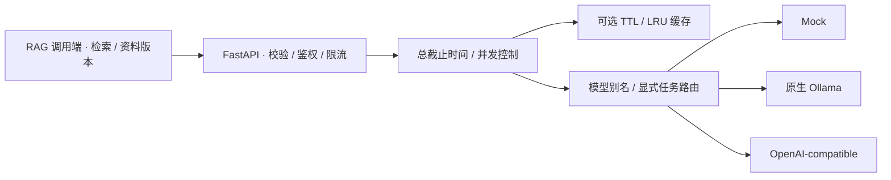

# LLM Gateway

[](https://github.com/FouHe0720/llm-gateway-service/actions/workflows/ci.yml)

一个异步 Python 模型网关，统一接入 Ollama 与 OpenAI-compatible 服务，处理流式响应、总超时、有限重试、缓存和模型别名。默认 Mock，无需模型或 API Key。

校园咨询是仓库里的一个具体调用场景：RAG 先检索山东大学威海校区资料，再把带出处的摘录交给网关。网关负责调用与资源边界，调用端负责资料版本和证据预算。

[完整使用手册](docs/USER_GUIDE.md) · [运行校园示例](#运行校园示例) · [来源与场景](docs/CAMPUS_SCENARIO.md) · [实测实验](docs/BENCHMARK_RESULTS.md) · [接口](docs/API.md)

## 校园咨询怎么接入

新生反复询问选课时间，适合复用相同资料下的回答；资料变动后，旧回答就不应继续命中。2024 年通知也不能直接用来回答 2026 级的安排。

[`examples/campus_client.py`](examples/campus_client.py) 演示检索之后的调用端：

| 问题 | 处理方式 |
| --- | --- |
| 资料可追溯 | 校验摘录 SHA-256 和段落一致性，Prompt 保留资料年份及原文段号 |
| 相同问题重复调用 | temperature=0，使用网关已有 TTL/LRU 缓存 |
| 引用内容或版本变化 | 资料指纹进入请求；变化后生成不同缓存键 |
| 资料年份、校区不符 | 在调用模型前返回资料不足，不套用历史通知 |
| 上下文和生成量 | 显式限制证据字符数与 max_tokens |
| 费用记录 | 只用上游实报 token 和调用方提供的价格计算；缺一项则为 null |

原始知识库中选择了 8 份资料的必要摘录，覆盖选课、英语分级、实验班与培养方案。没有附整库 DOCX 或个人联系方式。培养方案的“2024版”不等于“2024级”；原文的例外和歧义也需要保留。

## 运行校园示例

Python 3.11+，推荐 3.12；Linux / WSL：

```bash
make install
make campus-demo
```

示例在进程内启动真实 FastAPI 应用并使用 HTTP 客户端调用，依次检查：首次请求 miss、重复请求 hit、更换证据 miss、翻译学院相关请求、错误模型 404、2026 年资料缺失时不调用模型。报告写入 `runtime/campus-demo.json`。

**Mock 只回显请求，不生成校园政策答案。** 该示例验证调用链、缓存与错误边界，不代表模型问答质量，也没有测得生产收益。学校资料是 2023/2024 年历史摘录，不是当前办事依据。[场景说明与来源](docs/CAMPUS_SCENARIO.md)。

## 普通接口与真实模型

```bash
make demo                   # 普通请求、SSE、错误处理，结束后退出
cp -n .env.example .env
make run                    # 保留服务
```

```bash
curl -sS http://127.0.0.1:8000/v1/chat \
  -H 'Content-Type: application/json' \
  --data-binary @examples/chat.json

curl -N http://127.0.0.1:8000/v1/chat/stream \
  -H 'Content-Type: application/json' \
  --data-binary @examples/chat.json
```

接口文档：<http://127.0.0.1:8000/docs>。SSE 按 `start → delta → done` 返回，流内失败以 `error` 结束。请求为自定义文本 API，支持 system/user/assistant，不支持工具调用或多模态。

接入已准备好的本地 Ollama，在 `.env` 中启用鉴权并配置公开模型别名：

```dotenv
GATEWAY_AUTH_ENABLED=true
GATEWAY_API_KEY=REPLACE_WITH_A_RANDOM_SECRET_AT_LEAST_16_CHARS
GATEWAY_MODELS='[{"model":"qwen-0.5b","provider":"ollama","upstream_model":"qwen2.5:0.5b"}]'
OLLAMA_BASE_URL=http://127.0.0.1:11434
OLLAMA_CONTEXT_LENGTH=1024
```

请求使用 `model: "qwen-0.5b"`，添加 `Authorization: Bearer <Gateway Key>`。校园调用端也可传入这个模型别名，再提交构建好的 ChatRequest；无需调整核心路由。双模型、任务路由与 OpenAI-compatible 配置见 [.env.example](.env.example) 和 [API](docs/API.md)。

## 请求与资源



Provider 共用异步连接池。总截止时间包含排队与退避，客户端断开后关闭上游流并释放并发名额。连接错误、429 和部分 5xx 可有限重试；读取超时不自动重放。非流式请求支持单跳回退，所有尝试共用预算；流开始后不重试或回退。

缓存只接收显式 temperature=0 的非流式成功请求，有条目、字节和 TTL 上限。metadata 返回尝试、回退、缓存与排队信息。日志不记录 Prompt、Key 或上游响应正文。[架构](docs/ARCHITECTURE.md) · [资源与错误取舍](docs/TECH_DECISIONS.md)。

## 已有实测

2026-10-21，在 RTX 3050 Laptop 4 GB / WSL2 / Ollama 0.34.4 上执行。Mock 8,031 条请求，真实 Qwen2.5 308 条请求；逐请求 CSV/JSONL 和源码指纹保留在仓库中。

| 实验 | 观测结果 |
| --- | --- |
| 网关开销 | 20 ms Mock、并发 1，热态配对 ΔP95 的三轮中位数 +3.05 ms |
| 重复推理缓存 | 真实 0.5B，每组 10 条、90% 重复，调用从 10 次到 1 次；含冷启动 P95 未改善 |
| 任务路由 | 固定 18 题两轮，全 0.5B / 全 1.5B / 任务路由严格匹配率为 22.2% / 55.6% / 33.3% |

这些是已有通用实验，**不是新增校园数据的模型实验**。路由没有优于全部使用 1.5B，频繁换模型的加载开销明显。样本小、硬件单一，不代表通用质量或生产容量。[完整结果](docs/BENCHMARK_RESULTS.md) · [失败分析](docs/FAILURE_ANALYSIS.md)。

```bash
make benchmark-mock-quick
make benchmark-report
.venv/bin/python -m http.server 8080 --bind 127.0.0.1
# http://127.0.0.1:8080/benchmarks/reports/index.html
```

## 验证与边界

```bash
make lint test demo
make campus-demo
```

测试覆盖 Provider、超时/重试、SSE 增量消费与取消、缓存/回退；校园调用端另外验证来源校验、资料修订导致缓存失效、范围拒绝及未知费用。CI 的 Python/Docker/Mock 实验流程与历史验证记录见 [VALIDATION](docs/VALIDATION.md)。

服务按单进程、单实例设计，限流、缓存和指标保存在内存中。多副本需要共享配额、缓存和指标聚合。健康接口只检查进程，不探测模型。示例不负责检索排序，也不提供学校官方服务。

代码采用 [MIT](LICENSE)。第三方学校原文的权利归原作者，代码许可证不覆盖摘录。[来源清单](examples/campus/manifest.json) · [代码导读](docs/CODE_WALKTHROUGH.md)。
