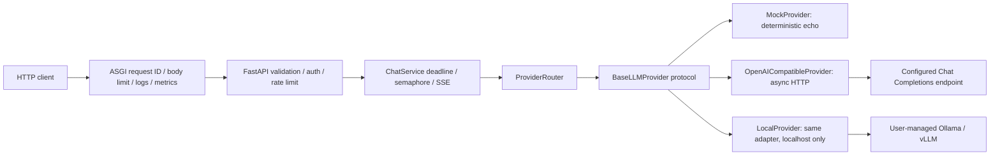

# LLM Gateway Service

[](https://github.com/FouHe0720/llm-gateway-service/actions/workflows/ci.yml)

一个可独立运行的异步 Python LLM 网关：统一文本对话、SSE、模型路由、鉴权、限流和可观测性。
面向多个客户端需要接入不同 OpenAI-compatible 服务的场景，把连接管理、错误边界和调用策略放在服务端。
默认 Mock 无需 API Key、GPU、模型下载或付费服务；安装依赖需要访问 PyPI，安装后 Mock 可断网运行。

**English overview:** An asynchronous FastAPI gateway for deterministic Mock and OpenAI-compatible
text models. Includes incremental SSE, cancellation, bounded retries/concurrency, Bearer authentication,
process-local rate limiting, structured logs and metrics. Runs independently with no paid API or GPU.

## 能力与架构

- `BaseLLMProvider` 协议隔离业务与 HTTP 传输，配置别名控制可用模型；Local 复用相同 HTTP 协议。
- `httpx.AsyncClient` 生命周期连接池；区分连接/读取超时，总截止时间涵盖排队和退避。
- 真正增量读取上游 SSE；Mock 明确标注模拟分块；断开连接会取消流并关闭上游连接。
- Bearer Key 常量时间比较、单进程滑动窗口限流、安全 request ID、统一 JSON 错误。
- 固定路由标签的请求/失败/取消计数、延迟累计桶；日志不输出 prompt、Key、上游响应正文或 URL。



## Quick Start

Python **3.11+**，推荐 3.12；Linux/WSL bash。已安装 uv 时使用锁文件；否则需要可用的标准 venv/pip。
本次 WSL 缺少 ensurepip，实际用已有 uv 创建项目 `.venv`，没有安装系统包。

```bash
git clone https://github.com/FouHe0720/llm-gateway-service.git
cd llm-gateway-service
make install
make demo
```

`make demo` 自动在 localhost 空闲端口启动仅有 Mock 的实例，逐块打印 SSE，验证所有主要接口后退出，
不会读取 `.env` 中的真实模型配置。持续启动服务：

```bash
cp -n .env.example .env
make run
# 新终端，同一项目目录：
make smoke
```

默认地址 `http://127.0.0.1:8000`；Swagger UI：`http://127.0.0.1:8000/docs`。
`.env.example` 显式设置 development + Mock + `GATEWAY_AUTH_ENABLED=false`。
直接启动而没有这个配置时，应用默认要求 Gateway Key；不会悄悄关闭鉴权。

```bash
curl -sS http://127.0.0.1:8000/health
curl -sS http://127.0.0.1:8000/v1/models
curl -sS http://127.0.0.1:8000/metrics
curl -sS http://127.0.0.1:8000/v1/chat \
  -H 'Content-Type: application/json' -H 'X-Request-ID: example-chat' \
  --data-binary @examples/chat.json
curl -N http://127.0.0.1:8000/v1/chat/stream \
  -H 'Content-Type: application/json' --data-binary @examples/chat.json
```

Chat 示例结构（request ID / latency 为每次实际执行值，下例时间仅说明字段）：

```json
{"answer":"[mock] Hello Gateway","model":"mock-echo","request_id":"example-chat","usage":null,"latency_ms":0.1}
```

Mock 不计算 token、不执行真实推理；生成参数经过校验，但 Mock 回显不模拟采样和 token 截断。
`examples/` 是本项目自建的公开虚构样例，随 MIT License 分发。

## API 契约

| 接口 | 行为 |
| --- | --- |
| `POST /v1/chat` | answer / model（公开别名）/ request_id / usage / latency_ms |
| `POST /v1/chat/stream` | SSE `start → delta* → done`，发生故障以 `error` 终止 |
| `GET /v1/models` | 启用的 model/provider 映射与 simulated_stream，不暴露上游模型名、URL、Key |
| `GET /health` | 无需鉴权、无上游调用，仅返回 `{"status":"ok"}` |
| `GET /metrics` | 结构化 JSON；启用鉴权时需要 Key；不消耗 API 限流窗口 |
| `GET /docs`, `/openapi.json` | 公开 API 文档和成功/错误示例，不包含运行时配置 |

`messages` 1–100 条，仅 system/user/assistant；每条非空且最多 16000 字符，总计最多 32000 字符；
原始 HTTP body 默认上限 128 KiB。`temperature` 0–2，`top_p` >0 且 ≤1，`max_tokens` 整数 1–8192。
未知字段会拒绝。不是 OpenAI API 的逐字段透传接口，暂不支持工具调用、多模态和 Responses API。

错误格式：`{"error":{"code":"model_not_found","message":"Requested model is not enabled","request_id":"..."}}`。
401=入站鉴权失败；429 的 `rate_limited`=Gateway、`provider_rate_limited`=上游；
404=模型未知或禁用；422=输入不合法；413=body 过大；502=上游错误/协议错误；504=超时。
SSE 开始后的 HTTP status 已为 200，此后失败用 `error` 事件表示，不发送 `done`。
客户端必须检查终止事件；只收到部分 delta 不代表请求成功。每个事件均包含 request_id（error 位于 error 对象中）。
usage 只使用 Provider 返回值，缺失为 `null`，中断流不保证有 usage。

## 接入真实服务

仅在你准备好自建或第三方 endpoint 时手动启用；本项目没有预置私人地址和密钥。
修改私有 `.env` 并重启：

```dotenv
GATEWAY_AUTH_ENABLED=true
GATEWAY_ENVIRONMENT=production
GATEWAY_API_KEY=REPLACE_WITH_A_RANDOM_SECRET_AT_LEAST_16_CHARS
GATEWAY_MODELS='[{"model":"online-chat","provider":"openai","upstream_model":"YOUR_MODEL","enabled":true}]'
OPENAI_BASE_URL=https://api.openai.com/v1
OPENAI_API_KEY=REPLACE_PRIVATELY
```

Base URL 应以 `/v1` 等 API 前缀结尾，适配器自动追加 `/chat/completions`。
普通请求只传显式设置的生成参数；流请求发送 `stream=true` 与 `stream_options.include_usage=true`。
第三方服务必须支持这一文本 SSE 子集，否则返回协议错误；没有隐式兼容性降级。
[OpenAI 官方流协议](https://developers.openai.com/api/reference/resources/chat/subresources/completions/streaming-events)
说明 usage 可在 choices 为空的最后一块返回；实现处理了这一情况。

请求时发送 `Authorization: Bearer <你的 Gateway Key>`。Gateway Key 与上游 Key 分开管理；
不要把上游 Key 发送给本服务客户端。可以在 `/docs` 的 Authorize 中填入 Gateway Key。

Local 示例（仍需开启 Gateway 鉴权）：

```dotenv
GATEWAY_MODELS='[{"model":"local-chat","provider":"local","upstream_model":"YOUR_INSTALLED_MODEL"}]'
LOCAL_BASE_URL=http://127.0.0.1:11434/v1
# LOCAL_API_KEY=仅在本地 endpoint 要求时设置
```

Local 是共享 HTTP adapter 的薄子类，配置仅允许 localhost/127.0.0.1/::1；不会安装 Ollama、启动模型或下载权重。
容器的 localhost 是容器自身；连接宿主机/其他容器 endpoint 时使用 `openai` provider 配置可达地址与 Key，
或在 WSL 本机运行 Gateway。未配置的真实 LLM、Ollama/vLLM 本次没有实测。

## 验证与容器

```bash
make install
make lint
make test
make demo
.venv/bin/python -m scripts.privacy_check
docker compose config --quiet
docker build --check .
docker compose up --build -d --wait
make smoke
docker compose down
```

截至 **2026-10-20** 的实际记录见 [VALIDATION.md](docs/VALIDATION.md)：Python 3.12 本地测试 **62 passed**，
Ruff check/format 通过，Mock TCP Demo 通过，Docker 镜像构建及非 root/只读容器的 API 和健康检查通过。
HTTP transport fixture 与真实 localhost 故障服务器覆盖 429/5xx/401/读取超时、限定重试、断流、取消和并发。
这些结果是功能验证，没有测量吞吐/QPS 或真实模型质量。
GitHub Actions 配置运行 Python 3.11/3.12/3.13 和 Docker；远端运行结果以 Actions 页面为准。

## 设计取舍与安全边界

- 默认最多额外重试两次，仅针对连接失败/连接超时/读取连接错误、429、500/502/503/504；指数退避 + full jitter。
  **不自动重试读取超时**，普通生成重试仍可能重复计费：上游接受 POST 后掉线，网关无法证明它没有执行。
  成本敏感场景设置 `UPSTREAM_MAX_RETRIES=0`。SSE 发送 start 后一律不重试。
- 总截止时间默认 60 秒，包括并发排队和退避；连接超时 3 秒、读取无数据超时 20 秒；上游并发上限默认 8。
  等待者没有单独队列长度上限，生产入口还需控制连接数和请求量。
- 限流为**整个实例共享**的 60 请求/60 秒滑动窗口，在认证后计算，Chat/Stream/Models 共用。
  不是按用户配额；多进程、多副本需 Redis/shared store，当前指标也需外部聚合，重启后清零。
- request ID 只接受 1–64 位字母/数字/点/下划线/连字符，否则重新生成；不作为指标标签。
  `/metrics` 的 active_requests 包含当前抓取请求，请求计数和延迟在请求完成后更新。
- 无 Key 的 Mock 只用于 localhost 开发。生产应使用 TLS、反向代理、密钥管理和网络访问控制。
  HTTP endpoint 可用于本地自建，公网应使用 HTTPS；关闭重定向，不从请求接收 URL，HTTP client 不读取代理环境变量。
  客户端断开只保证网关取消与关闭连接，远端模型是否停止推理由上游决定。

后续可扩展 Redis 配额、公平队列、OpenTelemetry、熔断、独立 readiness 和 Provider 能力声明；当前均未实现。
不包含持久化会话、计费系统、模型评测或 GPU 训练。

## 导航

- [ARCHITECTURE](docs/ARCHITECTURE.md)：模块交互、错误与资源生命周期
- [DEMO](docs/DEMO.md)：可复制的正常/错误/流式演示
- [INTERVIEW_GUIDE](docs/INTERVIEW_GUIDE.md)：10 个基于实现的面试问答
- [RESUME_BULLETS](docs/RESUME_BULLETS.md)：不虚构指标的简历描述
- [TECH_DECISIONS](docs/TECH_DECISIONS.md)、[IMPLEMENTATION_PLAN](docs/IMPLEMENTATION_PLAN.md)

License: [MIT](LICENSE).
