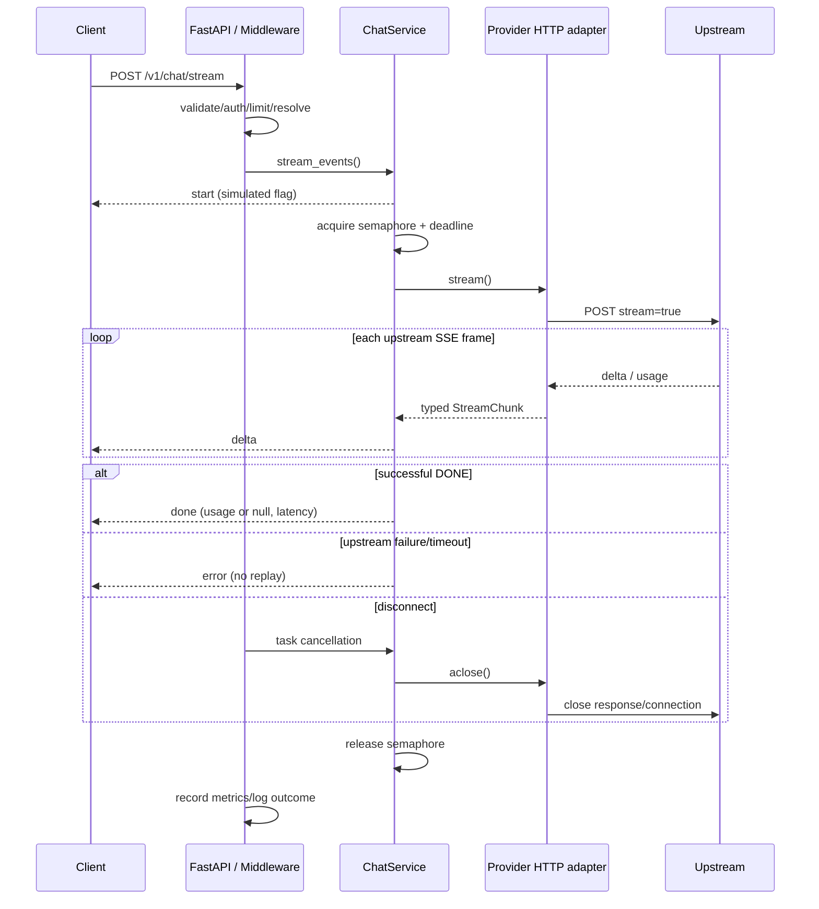

# 架构与执行路径

## 模块职责

| 层 | 文件 | 职责 |
| --- | --- | --- |
| API | `app/api/routes/`、`app/api/errors.py` | Pydantic 输入、HTTP/SSE 契约、统一错误、OpenAPI |
| Domain | `app/domain/schemas.py`、`errors.py` | 文本消息、响应、Provider 错误类型 |
| Core | `app/core/config.py`、`security.py`、`logging.py` | 配置校验、鉴权、日志格式 |
| Service | `app/services/chat_service.py` | 路由调用、总截止时间、并发上限、SSE 事件与取消清理 |
| Adapter | `app/providers/` | Protocol、Mock、HTTP、Local、模型 Router |
| Middleware/Infra | `app/middleware/`、`app/infra/metrics.py` | request ID、body 上限、窗口限流、固定维度指标 |
| Composition | `app/main.py` | App factory 和 lifespan，组装依赖，关闭连接池 |

## 一次普通请求

1. 纯 ASGI middleware 校验 request ID（否则生成 UUID），限制 body 大小；不会写入日志正文。
2. FastAPI guard 校验 Bearer Key，`compare_digest` 比较 UTF-8 bytes；认证成功才消耗限流名额。
3. Pydantic 检查消息、角色、总字符数、参数和未知字段，错误响应不回显原始输入。
4. Router 按公开别名定位 enabled 映射，未知/禁用模型返回 404；客户端不能指定 endpoint。
5. Service 在总截止时间内获取共享 Semaphore，调用 Provider；模型内部名只传上游。
6. HTTP adapter 将响应转成 Generation，Service 转稳定 ChatResponse。usage 不可得时为 null。
7. middleware 完成计数、延迟桶、结构化日志，响应头回显 X-Request-ID。

Pydantic/HTTP 解析细节的先后由 FastAPI 决定；认证依赖与业务输入验证均在真正调用 Provider 之前。

## 流与资源

应用的一个 httpx.AsyncClient 在 lifespan 创建/关闭，所有 HTTP/Local Provider 共享连接池。
`stream()` 返回可关闭的 AsyncGenerator；Service 使用 aclosing 和取消屏蔽的 finally 清理，
Semaphore 的 async context 确保异常、超时和取消均释放并发名额。
Starlette StreamingResponse 负责 ASGI 断开检测，纯 ASGI middleware 保留原生 receive/send 语义。
真实双 TCP 服务测试用 Event 卡住第二块，先读取第一块再主动断开，并检查上游 finally 与名额释放。

上游 SSE 按空行分帧，支持 CRLF、多段网络 chunk、注释与多行 data；单帧最多 64 KiB。
只提取第一个 choice 的文本 delta，usage 独立处理；缺少 `[DONE]` 视为截断错误。
不会把已完成的在线响应切片冒充流；仅 Mock 是确定性文本的模拟分块。
同步完整响应上限可配置，默认 1 MiB；异步迭代与 await 自然传递下游背压，不累计完整 stream answer。

## 错误与重试

ProviderRateLimit → 429 / provider_rate_limited；ProviderTimeout → 504；其余 ProviderError → 502。
Gateway 认证失败 401、窗口超限 429/rate_limited。外部错误信息不包含上游正文/headers/URL。
非预期内部异常统一 internal_error，流启动后转 error 事件。
SSE 的 HTTP 状态只能在 start 前设定；未知模型、输入、鉴权/限流失败返回 JSON 4xx。

普通生成最多 1 + UPSTREAM_MAX_RETRIES 次，full jitter 上界 base × 2^attempt，期间占有并发名额。
适配器不重试普通的 ReadTimeout；其他连接类重试仍可能重复执行，不能宣称 exactly once。
流从 start 开始完全禁用重试；收到部分内容后出错时不进行透明补全。

## 配置与运维

Settings 读取 `.env`/环境变量；环境变量优先。启动时验证 Key、模型别名唯一、至少一个模型启用、
Provider URL/凭据及 Local hostname；无 Provider 时不会建立模型连接或探测模型。
Router 映射启动时载入，更改配置需重启。模型列表仅展示公开别名/provider/模拟标记。
Local 为共享 HTTP adapter 的薄子类，没有额外推理引擎。

单实例滑动窗口使用有界 deque；consume 内没有 await，单事件循环下检查/追加不可交错。
它为整个实例提供粗粒度保护，不区分用户，也不共享多 worker 的状态。
指标按固定路由集合分类，未知 path 合并 other；失败包括 HTTP 4xx/5xx 与 SSE error，取消单独计数。
latency 桶累计，单位毫秒；反映整个 HTTP/stream 生命周期，非单纯模型时间。
ChatResponse.latency_ms 从路由解析后到 Provider 完成，含并发排队/退避，不含入站解析。

健康探针只确认进程能响应，不保证真实上游可用。Docker 默认单 worker、非 root、健康检查；
Compose 默认仅绑定 localhost、只读根文件系统、无 capabilities。未实现 TLS/分布式存储/真实计费。

## 可选策略与原生 Ollama

默认仍只开启 Mock，缓存/Fallback/任务路由均需运维显式配置。

- `app/infra/cache.py`：有条数和答案字节预算的 TTL/LRU；只缓存显式 temperature=0 的非流式成功回答。
  key 为完整请求与映射命名空间的 SHA-256，命中不复用旧 request ID/usage/timing。
- `ModelMapping.fallback_model`：只允许一个启用的、无后继的备用别名；配置时拒绝循环。
  Service 的整个调用共用 Deadline、Semaphore 与 attempt budget。流不 fallback，永久 HTTP 4xx 不 fallback。
- `app/core/trace.py`：ContextVar 隔离并发请求的尝试计数与 request ID，安全地透传到上游；
  metadata 公开已服务的模型别名、尝试/重试/回退/缓存状态/排队耗时，不公开凭据或上游 URL。
- `app/providers/ollama.py`：复用 HTTP 生成/重试与错误边界，重写 native payload/NDJSON 流读取，
  将原生 usage/纳秒 timing 转为统一结果。Ollama API 仅连接 localhost，不下载模型。
- `gateway_task_routes`：调用方用 model=auto + task_type 选择配置别名。输入类型声明由调用方提供，
  没有隐式分类器；不能把它当作自动判断问题难度的模型。

`benchmarks/` 与服务实现分开，负载客户端/Gateway/HTTP fixture 运行于独立进程。
实验从客户端单调时钟量端到端与首块延迟，上游台账核对调用次数；原生 timing 只作模型内部指标。
每次运行保存源码快照、硬件/模型/参数清单、逐请求记录、分组统计与多轮波动。
HTML 报告只展示已生成的观测数据，截图来自真实离线浏览器渲染。

## 校园调用示例

`examples/campus_client.py` 负责检索后的资料版本检查、证据预算、段落引用和快照构建；输出已有 ChatRequest，不改变网关 API。`scripts/demo_campus.py` 使用同一个 App 工厂验证缓存和错误边界，Provider 固定 Mock。来源与验证范围见 [校园场景](CAMPUS_SCENARIO.md)。
